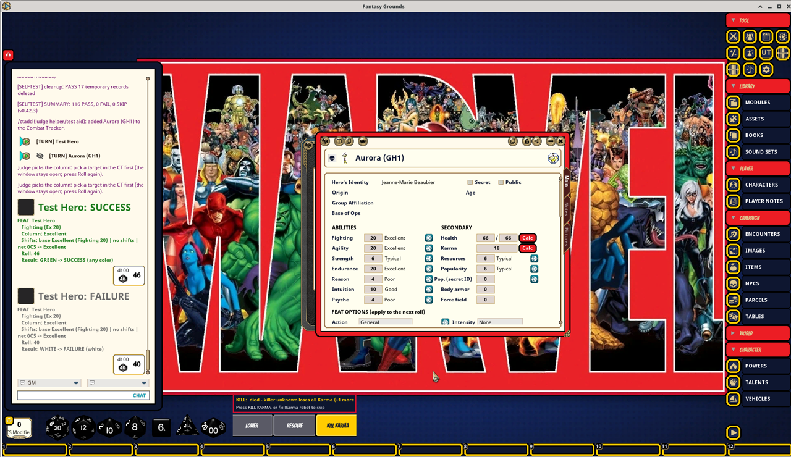
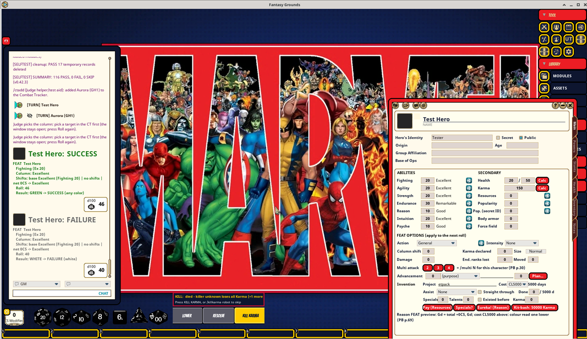

# MSH_FG_Releases: Marvel Super Heroes (FASERIP) for Fantasy Grounds Unity

An unofficial, fan-made ruleset for the 1984 TSR *Marvel Super Heroes* Advanced Set (FASERIP), layered on CoreRPG for Fantasy Grounds Unity (tested on 5.1.15). Current version: **v0.42.1**.

This project is not affiliated with or endorsed by Marvel, Disney, TSR or Wizards of the Coast. It is for personal use with books you own.

## Screenshots

*An NPC from the Gamers Handbook modules: ability ranks, Health, Karma, identity and FEAT options.*

*A hero sheet with FEAT rolls. Every roll's chat card lists the column, each shift and the net result.*

## What the ruleset does

- FASERIP character sheets: abilities, Health, Karma, Resources, Popularity, powers, talents and contacts.
- Universal Table rolls with column shifts. Every roll's chat line lists each shift and the total.
- Combat tracker with Health, Stun, Slam, Dying, Charging, Catching, fire and cold effects, the Surprised state and the Judge's rider effects.
- Karma and Karma pool handling, including Stabilize.
- Hazards: falling, drowning, suffocation, poison and disease.
- Hardware (Invention) panel, vehicles and a Judge-pick-the-column picker for powers the book leaves open.
- Module filter on NPCs, Encounters and Items.
- A built-in `/selftest` that checks the rules engine inside Fantasy Grounds.

Anything that is a house rule or an inference rather than a printed rule is labelled **"not from the book"** in chat, and limit checks only warn. Book references use PB p.N (Players Book) and JB p.N (Judges Book).

## Source

The source code is kept private. This repo only publishes releases and takes bug reports.

## Install

1. Download the files from the latest [Release](../../releases).
2. Put `MarvelSuperHeroes.pak` in `<FG data>/rulesets/` and the `.mod` files in `<FG data>/modules/`.
3. Restart Fantasy Grounds, create a campaign with the Marvel Super Heroes ruleset, and load the modules you want.

Rulesets are only scanned at startup, so restart after updating the pak.

## Modules

- **MSH Ruleset Guide**: how every feature works.
- **MSH Gamers Handbook 1-4 and the 1989, 1990, 1991, 1992 and 2016 Update mods**: heroes, villains, cosmic entities and teams as NPC records.
- **MSH Advanced Set Characters and Data**: the core character and reference data.

## Reporting bugs and requests

Open an [issue](../../issues/new/choose) and pick a template. Please include the ruleset version (shown in the chat announcement when a campaign loads), which modules were loaded, the steps to reproduce, and a screenshot or the `/selftest` result if you can.

## Status and testing

Each release's notes say what has been tested in real Fantasy Grounds and what is only mock-tested.
